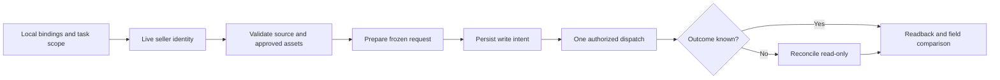

# Alibaba Listing Toolkit

[](https://github.com/alan113523/alibaba-listing-toolkit/actions/workflows/ci.yml)
[](LICENSE)
[](package.json)

**Reusable draft and photobank building blocks for authorized Alibaba.com seller workflows.**

Keep seller identity, approved assets, write intent and readback together. A lost response becomes a reconciliation task; it does not trigger a second write.

[简体中文](README.zh-CN.md) · [Quick start](#quick-start) · [API guide](docs/api.md) · [Workflow](docs/workflow.md) · [Contributing](CONTRIBUTING.md)

## What you get

- **Identity-bound execution:** compare the current seller with a locally configured expectation before and after operations.
- **Draft adapters:** create similar-product drafts, preserve protected fields, attach locally verified image mappings and compare readbacks.
- **Photobank helpers:** validate source bytes and approval evidence, reuse known mappings, upload bounded batches and reconcile ambiguous outcomes.
- **Durable intent:** record the intended write before dispatch; retain uncertain outcomes and block blind retries.
- **Offline tests:** synthetic files, store identities and in-memory fetch/CDP responses. No seller login is needed to run the suite.
- **No runtime dependencies:** Node.js standard library modules; the caller supplies an authorized browser capability.

## Scope

| Area | Included |
| --- | --- |
| Similar-product draft creation and readback | Executable adapters |
| Approved image selection and draft image mapping | Executable local helpers |
| Photobank upload, reuse and reconciliation | Executable adapters |
| Multi-store isolation and bounded batches | Explicitly configured helpers |
| Full master preparation, quality review and final publication | Workflow documentation; business-specific production launchers are excluded |
| Browser launching or an MCP server | Supplied by your host environment, not this repository |

This is an unofficial integration using seller-session web interfaces. It is not an Alibaba SDK or a ready-to-run publishing service. Endpoint/component contracts can change; draft parsing checks a specific observed frontend version. Verify the current platform contract before live use.

## Quick start

Requirements: **Node.js 22 or newer**, Git, and npm for the command aliases. There are no packages to install.

```sh
git clone https://github.com/alan113523/alibaba-listing-toolkit.git
cd alibaba-listing-toolkit
npm run check
npm test
```

`npm test` creates an isolated temporary workspace with synthetic configuration. It neither reads your local seller configuration nor opens a browser. Temporary data is removed when the run finishes.

## Use with an authorized seller session

1. Copy each package's `bindings.example.json` to that package's `.local/store-bindings.json`, creating `.local/` as needed.
2. Fill the local bindings with seller values you have independently verified. The examples contain empty placeholders and intentionally fail validation.
3. Supply a documented in-process CDP-compatible handle from your authorized host. The required interface is described in [the API guide](docs/api.md).
4. Start with local asset validation or read-only reconciliation. Create a draft or upload only within an explicitly authorized task.

```js
import { createConcurrentDraftAdapter } from './packages/alibaba-draft-interface/similar-draft.mjs';

// cdp, shopId, sourceProductId and authorizedRunDirectory come from your host/task.
const adapter = await createConcurrentDraftAdapter({
  cdp,
  shop: shopId,
  sourceId: sourceProductId,
  count: 1,
  runDir: authorizedRunDirectory
});

await adapter.prepare();
await adapter.preflight();
// After reviewing the prepared request under the current task authorization:
await adapter.saveOnce();
await adapter.readback();
```

Keep the same run directory for reconciliation. An intent marker prevents another save; deleting it or switching directories defeats that protection.

## How the pieces fit



An accepted HTTP response, a saved draft and a displayed listing are separate states. The public draft adapters do not claim that a product has passed review or gone live.

## Repository layout

```text
packages/
  alibaba-draft-interface/  Draft adapters, comparison and config validation
  alibaba-photobank/        Image validation, upload/reuse and local mappings
docs/                      API, workflow and release provenance
scripts/                   Offline test runner and source checks
SAFE_FILES.txt             Reviewed public file allowlist
```

Actual seller bindings, business inputs, media, payloads, receipts, screenshots and historical runs are excluded. The repository uses a deny-by-default Git allowlist. Public tests use invented store keys and generated image bytes.

## Documentation and support

- [API guide and host contract](docs/api.md)
- [Workflow and status vocabulary](docs/workflow.md)
- [Release provenance and documentation references](docs/provenance.md)
- [Contribution guide](CONTRIBUTING.md)
- [Security reporting](SECURITY.md)

When reporting a bug, provide a minimal synthetic reproduction, the Node version and the redacted error code. Keep seller credentials, platform payloads and business records out of issues.

## License

[MIT](LICENSE). Alibaba and other product names belong to their respective owners; this project is independent and unaffiliated.
